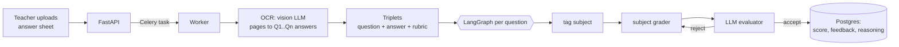
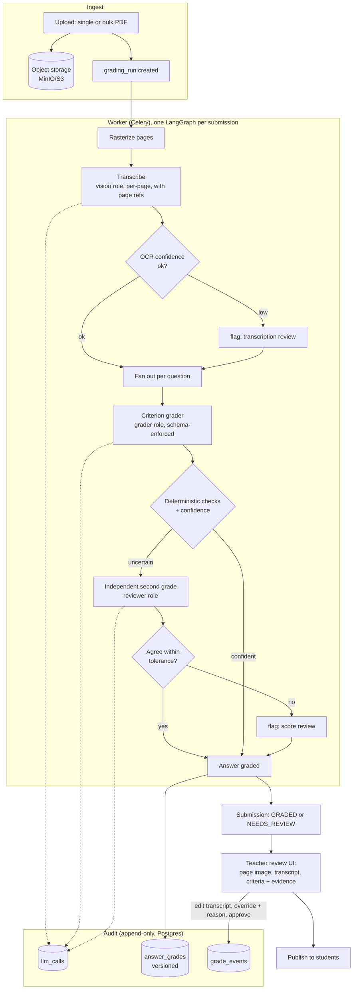
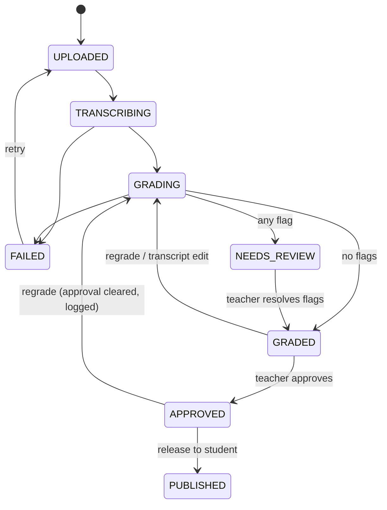

# Proposal 001: Production-grade grading workflow

| | |
|---|---|
| **Status** | **Superseded** by [Proposal 002](002-grading-v2-architecture.md) (2026-10-05). Kept as the original draft for history; several recommendations here (e.g. dropping the evaluator loop, raw-SDK adapters) were changed in 002. |
| **Branch** | `v1-full` (based on `added-exams`, plus the bug-fix commits) |

---

## 1. Summary

The agentic grading pipeline now works end to end after the bug-fix commits on this branch. It is not production grade yet, for four reasons:

1. **Nobody can check a grade afterwards.** Prompts, raw model outputs, the model used, retries and evaluator verdicts are all thrown away. Only the final score, feedback and reasoning are saved.
2. **The score is a single number the model invents.** The grader reads the rubric but returns one holistic score, so there is no per-criterion breakdown, no evidence, and no reliable way to compare two runs.
3. **There is no human step.** Every result goes straight to `GRADED`. Low OCR or grader confidence is never surfaced, and teachers cannot correct a transcription or override a score with a reason.
4. **Infrastructure is still MVP-grade.** There are no migrations, files live on local disk, there's no CI, no evaluation set, no cost tracking, and the system is tied to one provider at a time.

The proposal fixes these in order of value:

| | Change | One-line rationale |
|---|---|---|
| A | **Pluggable model layer.** Claude by API key (Opus 5.5 for OCR and review, Sonnet 5.5 for first-pass grading), plus any OpenAI-compatible endpoint (OpenAI, or open-source models via Ollama, vLLM, LM Studio). Each role is configured separately. | Choose cost, privacy and quality per role. |
| B | **Criterion-level rubric grading.** Every rubric point gets an award plus a quoted piece of evidence; code sums the awards into the score. | The score can be explained and checked, and runs stay consistent. |
| C | **Audit trail in Postgres.** Every run, every LLM call and every human change is stored, append-only. | Any grade can be reconstructed and defended. |
| D | **Review workflow.** Uncertain answers are flagged for review; teachers correct transcriptions, override with a reason, approve, then publish. | A human signs off, but only on the answers that need it. |
| E | **Production hardening.** Alembic, object storage, CI, an evaluation set, cost tracking, rate limits. | Safe to change and safe to run. |

LangGraph stays. It's model-agnostic, and Section 4.1 explains why it's still the right tool.

---

## 2. Where we are now (after the bug fixes)



| Area | State |
|---|---|
| Correctness | Fixed: answers map to the right question, rubrics reach the grader, no silent zeros, and runs no longer leak state. 46 tests pass on SQLite and Postgres. |
| Providers | OpenAI **or** Anthropic for the whole app, with no per-role mix and no open-source endpoint. |
| Output parsing | Prompt says "return JSON", then the code extracts and validates it. No schema-enforced output. |
| Audit | Final score, feedback and reasoning only. ADR-009 promised "audit trail of attempts", but attempts were never persisted. |
| Grading quality control | An LLM evaluator accepts or rejects, retrying up to 3 times. |
| Human in the loop | None. The `APPROVED` and `PUBLISHED` states exist in the enum but nothing uses them. |
| Infra | `create_all` instead of migrations, local disk instead of MinIO (which is in compose but unused), no CI, no evaluations. |

---

## 3. Target architecture



---

## 4. Design decisions and tradeoffs

Each subsection gives the options, how they compare, and a recommendation. The recommendations add up to the POC in Section 9.

### 4.1 Orchestration

| Option | Pros | Cons |
|---|---|---|
| **A. Keep LangGraph and restructure the graph** *(recommended)* | Already in the codebase and known to the team. Model-agnostic: nodes call our own model layer. Conditional routing, retries and fan-out (`Send`) suit "flag or second opinion" logic. Matches the roadmap (AGNTCY, observability). | The checkpointer brings little unless backed by Postgres. One more abstraction to learn. |
| B. Plain async Python pipeline | Simplest to read and debug. No framework lock-in. | Branching, fan-out and retries are hand-written. Drifts from the documented architecture. |
| C. Durable workflow engine (Temporal, Prefect) | Survives worker crashes mid-run, retries per step, built-in history UI. | New infrastructure to run. Overkill until we grade thousands of scripts a day. |
| D. A plus LangGraph's Postgres checkpointer | Resume a run from its last completed step after a crash. Inspect state. | Its stored checkpoints overlap with the audit tables. More schema to manage. |

**Recommendation: A now, with D as an option later.** One graph per **submission**: transcribe, then fan out per question, then aggregate. Celery stays as the queue. The current per-question graph (tag, grade, evaluate loop) is replaced by the grading node in 4.2.

### 4.2 Grading mechanism (the core quality decision)

| Option | How it works | Pros | Cons |
|---|---|---|---|
| Current: holistic score with an LLM evaluator loop | Grader returns one score; a second LLM approves or rejects and asks for a regrade, up to 3 times. | Simple. | The score isn't explainable. The evaluator mostly rubber-stamps, and re-prompting until it approves tends to drift toward agreement, not correctness. It costs 3–7 calls per question. Nothing is persisted. |
| **B. Criterion-level rubric scoring** *(recommended)* | The rubric becomes criteria, each with points. The model returns, for each criterion, `awarded_points`, a verbatim `evidence` quote from the answer and a short `justification`. **Code** sums the awards and enforces bounds. | Every mark points to a rubric line and a quote, and teachers see exactly why. Deterministic aggregation. Easy to audit and to override per criterion. Pairs naturally with schema-enforced outputs. | Rubrics need structure (handled in 4.6). Slightly longer prompts. |
| C. Self-consistency ensemble | Grade N times, take the median, use the spread as uncertainty. | Measurable uncertainty. Robust to one-off errors. | Costs N times as much on every answer. |
| D. Calibrated with anchors | Include teacher-graded example answers (few-shot) per question. | Big consistency gains on subjective questions. | Needs exemplars from teachers. |

**Recommendation: B as the base, plus a *targeted* version of C, then D later.**
- A second, independent grade (reviewer role, Opus 5.5) runs **only** when a deterministic check trips:
  - grader confidence is below a threshold,
  - OCR confidence is low,
  - an evidence quote doesn't appear in the transcript (a cheap check against made-up evidence),
  - the answer is near a grade boundary.
- If the two grades disagree by more than X% of the question's marks, the answer is **flagged for human review** instead of looping.
- This replaces ADR-009's loop. It costs less, and disagreement is a better signal than an LLM judging its own output.
- D (anchors) comes once teachers have graded a few scripts. They come almost for free from overrides in the review UI.

The schema for one graded answer, enforced by the provider:

```json
{
  "criteria": [
    {"criterion_id": "c1", "awarded_points": 1.0, "max_points": 1.0,
     "evidence": "2x = 10", "justification": "Subtracted 5 from both sides correctly"}
  ],
  "overall_feedback": "…",
  "confidence": 0.86,
  "flags": ["illegible_section"]
}
```

### 4.3 Model and provider layer (API keys or open-source)

You asked for open-source models or API keys, and for LangGraph if it supports that. It does, because LangGraph doesn't care which model a node calls. The real choice is how we talk to models:

| Option | Pros | Cons |
|---|---|---|
| **A. Our own thin provider interface** *(recommended)*. Two adapters: **Anthropic SDK** and **OpenAI-compatible**. The second covers OpenAI, Ollama, vLLM, LM Studio, Together, Groq and others via `base_url`. | We control structured output per provider, token and cost capture, refusals and audit logging. Small: an extension of today's `llm_provider.py`. No heavy dependencies. | We maintain two adapters. |
| B. LangChain chat models (`ChatAnthropic`, `ChatOpenAI`, `ChatOllama`) | Many providers for free. Native LangGraph integration and LangSmith tracing. | Large dependency surface with frequent breaking changes. Structured-output behaviour differs per wrapper. Harder to capture exact prompts and raw outputs for the audit table. |
| C. LiteLLM (library or proxy) | One API for 100+ providers. Budgets and a fallback router built in. | Another moving part, or a proxy to run. Its abstraction hides provider-specific features we want, such as Claude's schema-enforced outputs and native PDF input. |

**Recommendation: A.** Configuration per **role** (vision, grader, reviewer):

```env
LLM_VISION_PROVIDER=anthropic   LLM_VISION_MODEL=claude-opus-5-5
LLM_GRADER_PROVIDER=anthropic   LLM_GRADER_MODEL=claude-sonnet-5-5
LLM_REVIEWER_PROVIDER=anthropic LLM_REVIEWER_MODEL=claude-opus-5-5
# Open-source example: point any role at an OpenAI-compatible server
# LLM_GRADER_PROVIDER=openai_compatible
# LLM_GRADER_BASE_URL=http://localhost:11434/v1   LLM_GRADER_MODEL=qwen3:32b
```

How each provider enforces the output schema:

| Provider | Mechanism | Reliability |
|---|---|---|
| Claude (Opus 5.5, Sonnet 5.5) | `output_config.format` JSON schema (structured outputs) | Guaranteed to match the schema |
| OpenAI | `response_format: json_schema` with `strict: true` | Guaranteed to match the schema |
| vLLM / LM Studio | `response_format` json_schema (constrained decoding) | Guaranteed when the server supports it |
| Ollama | `format` / `response_format` with a JSON schema | Good; model-dependent |
| Anything else | Validate with Pydantic, then one repair retry, then fail loudly | Best effort |

Claude-specific notes:
- Opus 5.5 and Sonnet 5.5 always think. We control depth with `effort`: `high` for OCR and review, and `medium` for first-pass grading, to be tuned with the evaluations in 4.8.
- I'd enable the API's **server-side refusal fallback** (`fallbacks: "default"`). A rare safety false positive on student text then gets rerouted instead of failing the submission. It can be turned off if you'd rather not use a beta feature.

Open-source caveats:
- Handwriting OCR quality from open vision models is still well behind Opus-class models.
- Recommended split for privacy-sensitive deployments: **local model for grading text, Claude for OCR**, or fully local with a mandatory review flag.
- The evaluation harness (4.8) is what tells us which open model is good enough.

### 4.4 OCR / transcription

| Option | Pros | Cons |
|---|---|---|
| **A. Rasterize pages, then a vision LLM, per page, with page references** *(recommended; extends today's approach)* | Works with every provider, including open-source vision models. Page images double as evidence in the review UI. Bounded request size. | Image tokens cost money. Long answers span pages, so they need stitching (already done). |
| B. Claude native PDF input | One request per document. The model sees layout. | Claude-only. Page-level evidence is harder to map. |
| C. Dedicated OCR (Azure Document Intelligence, Google Document AI, olmOCR, PaddleOCR), then an LLM to segment answers | Cheaper at volume. Word-level boxes, useful for highlighting. | Weaker on messy handwriting and math. Two systems to run. |

**Recommendation: A.** Make transcription a **separate stored artifact** (`transcriptions` table: page, question label, text, confidence, model). That gives three things:
- teachers can fix the transcription and regrade **without** re-running OCR;
- grading always runs on an inspectable text;
- OCR and grading quality can be evaluated separately.

### 4.5 Audit trail (system of record)

| Option | Pros | Cons |
|---|---|---|
| **A. Append-only audit tables in Postgres** *(recommended)* | Simple. Lives in the same transaction as the grade. Easy to query ("show every change to this score"). Exportable. | Needs a retention policy for prompt and response blobs. |
| B. Full event sourcing | Complete history by construction. Replayable. | Large shift in the code. Overkill here. |
| C. External tracing only (Langfuse, LangSmith, OpenTelemetry, AGNTCY Observe) | Great for debugging and latency or cost dashboards. | Not a system of record: sampled, separate retention, a third party holds student data. |

**Recommendation: A as the record, and C as an optional add-on** for engineering dashboards. The OTel or AGNTCY Observe hooks from the V1 roadmap fit here.

Proposed tables:

```text
grading_runs     id, submission_id, trigger (upload|regrade|transcript_edit), status,
                 pipeline_version, rubric_snapshot (jsonb), config_snapshot (jsonb: models,
                 effort, thresholds), started_at, finished_at, total_cost_usd, error
llm_calls        id, run_id, role (vision|grader|reviewer), question_id, provider, model,
                 request (jsonb, images by object-storage ref), response_raw, parsed (jsonb),
                 input_tokens, output_tokens, cost_usd, latency_ms, provider_request_id,
                 attempt, error, created_at
transcriptions   id, run_id, submission_id, question_id, text, confidence, pages[],
                 source (model|teacher), created_by, created_at          -- versioned
answer_grades    id, run_id, submission_answer_id, criteria (jsonb), score, confidence,
                 flags[], source (ai|teacher), is_current, created_at   -- versioned
grade_events     id, submission_id, answer_id, actor_membership_id, kind (override|approve|
                 publish|transcript_edit|regrade), before (jsonb), after (jsonb), reason,
                 created_at                                             -- append-only
```

`submission_answers.score` stays as a pointer to the current grade, so existing reads keep working. Nothing in the audit tables is ever updated in place. A correction adds a row.

### 4.6 Rubric format

| Option | Pros | Cons |
|---|---|---|
| Free text (today) | Easiest for teachers. | Point values are implicit, so criterion scoring is impossible. |
| **Structured criteria, optional AI drafting** *(recommended)* | Each criterion has a description and points that must sum to `max_score`. The UI can **draft** criteria from free text or a model answer, and the teacher confirms. | One extra step for teachers. |
| Upload a model answer only | Fast. | The model has to infer the scoring, which is less consistent. |

Store as `questions.rubric` (jsonb, versioned). Keep `rubric_criteria` text for backwards compatibility and convert it on first edit.

### 4.7 Workflow and states



- **Review queue** per exam, sorted by risk: flagged first, then lowest confidence, then score near pass or fail boundaries.
- **Review screen**: page image | transcript (editable) | criteria with evidence highlighted | override with a mandatory reason.
- **Bulk upload**: one class PDF gets split into students (by page markers, a roster QR or teacher assignment). This is required for real use, but it can come after the POC.
- **Publishing** is explicit and per exam. Students only ever see `PUBLISHED`.

| Option | Tradeoff |
|---|---|
| Review everything | Safest, but removes most of the time saving. |
| **Review flagged only, plus random spot-checks** *(recommended)* | Most of the time saving with measured risk. Spot-check results feed the evaluation set. |
| Review nothing (today) | Not acceptable for marks that count. |

### 4.8 Evaluation harness (how we know it's good)

Without this, every prompt, model or threshold change is a guess. That makes it the most important "production grade" item.

- **Golden set**: about 30–50 real answer sheets graded by teachers, with consent, anonymised, in a private bucket.
- **Metrics**: agreement with the teacher per question (mean absolute error, and quadratic-weighted kappa for banded marks), OCR character error rate on a transcribed subset, flag precision and recall (did we flag the answers teachers changed?), and cost and latency per script.
- **Runs**: `make eval CONFIG=…` compares model and effort configurations side by side. CI runs a small smoke subset on prompt changes.
- This is also how we decide **Opus 5.5 vs Sonnet 5.5 vs an open model** per role, using measurements instead of opinion.

### 4.9 Production hardening

| Item | Proposal | Alternatives / tradeoffs |
|---|---|---|
| DB migrations | **Alembic** with a baseline of the current schema, and `alembic upgrade head` on deploy. | Keep `create_all` and ad-hoc scripts (what exists now; it breaks on every column change). |
| File storage | **MinIO/S3** (already in compose) behind a `Storage` interface, with signed URLs for the review UI. | Local disk works for one node only, and API and worker must share a volume. |
| Task granularity | One task per submission, with concurrent questions inside it (asyncio and a semaphore). | One task per question parallelises more, but makes aggregation and idempotency harder. |
| Idempotency and retries | `grading_run` id as the idempotency key. Tenacity backoff on 429/5xx. Requests per minute capped per provider. | — |
| Cost control | Per-org monthly budget plus the per-run call cap (exists). Cost computed from tokens in `llm_calls`. | Cheaper alternative: the **Message Batches API** for overnight bulk grading (about 50% cheaper, results within hours). |
| Auth | httpOnly refresh cookies instead of a JS-readable token. Password-set/invite flow for roster users (they have no password since the fix). | — |
| Privacy | Data-processing note per provider. Option for fully local models. Strip names from prompts (questions and answers only). Retention policy for `llm_calls` blobs. | — |
| CI / SDLC | GitHub Actions running ruff, black --check, pytest (SQLite and a Postgres service), `next build` and lint. Branch protection on `master`, PRs required, conventional commits, pre-commit hooks. | — |
| Observability | JSON structlog with `run_id` and `submission_id` on every line, Sentry for errors, optional OTel or AGNTCY Observe traces. | — |

---

## 5. Rough cost per answer sheet

These are **estimates** for a 4-page, 10-question script. Real numbers come from the evaluation harness.

| Step | Model | Tokens (approx.) | Cost |
|---|---|---|---|
| Transcription | Opus 5.5 ($4 / $20 per MTok) | ~20k in (images) + ~3k out | ≈ $0.14 |
| First-pass grading ×10 | Sonnet 5.5 ($2 / $10 per MTok) | ~2k in + ~1.5k out each (incl. thinking) | ≈ $0.19 |
| Second opinion on ~20% of answers | Opus 5.5 | ~2k in + ~2k out each | ≈ $0.10 |
| **Total** | | | **≈ $0.43 per script** |

Levers:
- Prompt caching on the shared exam context: rubric and questions are reused across the class.
- The Batches API, about 50% off for overnight bulk runs.
- Lower effort where the evaluations show no loss.

---

## 6. Risks

| Risk | Mitigation |
|---|---|
| Rubric structuring adds friction for teachers | AI drafts the criteria; teacher confirms. Free text still accepted (one criterion). |
| Made-up evidence quotes | Deterministic check that each quote appears in the transcript, otherwise flag. |
| Open models underperform | Per-role configuration plus evaluations. Default to Claude for OCR. |
| Audit blobs grow large | Store images by reference. Compress or expire raw responses after N months (configurable). |
| Scope creep | POC limited to Section 9. Bulk split, student portal and anchors come later. |

---

## 7. What changes for each part of the codebase

| Area | Change |
|---|---|
| `core/llm_provider.py` | Per-role config. Anthropic and OpenAI-compatible adapters returning `LLMResult(parsed, raw, usage, model, latency)`. Schema-enforced output. |
| `agents/` | New submission graph (transcribe, fan-out grade, check, aggregate). Criterion grader prompt. Subject personas kept as system-prompt variants. The evaluator loop is removed. |
| `services/` | `audit.py` (records runs and calls), `storage.py` (MinIO), `review_service.py`. |
| `models/` + Alembic | New tables from 4.5. `questions.rubric` jsonb. New submission states. |
| API | Review endpoints (`PATCH transcript`, `POST override`, `POST approve`, `POST publish`), `GET submissions/{id}/audit`. |
| Frontend | Review screen, review queue, rubric criteria editor, audit timeline. |
| Tests | Graph tests with FakeLLM. Audit invariants (append-only, totals equal the sum of criteria). Evaluation harness. |

---

## 8. Phased roadmap

| Phase | Outcome | Size |
|---|---|---|
| **0. Done** | Bug fixes, tests, smoke-tested stack (this branch) | ✓ |
| **1. POC** (Section 9) | Pluggable providers, criterion grading, audit trail, review and override, evaluation harness v0 | ~2 weeks |
| 2. Hardening | Alembic, MinIO, CI, cost budgets, auth cookies, Sentry | ~1–2 weeks |
| 3. Scale and UX | Bulk class PDF split, review queue polish, anchors / few-shot, Batches API, student portal | ~2–3 weeks |

## 9. POC scope (what I'll build after approval)

1. **Provider layer**: per-role configuration, Anthropic and OpenAI-compatible adapters, schema-enforced outputs, token and cost capture. Tested with FakeLLM plus one live Claude run, and an Ollama run if you have it locally.
2. **Criterion-level grading** with evidence, deterministic aggregation, the evidence check, and a targeted second opinion with a disagreement flag.
3. **Audit tables** (`grading_runs`, `llm_calls`, versioned `transcriptions` and `answer_grades`, `grade_events`) via **Alembic**, with the baseline migration included.
4. **Review workflow**: `NEEDS_REVIEW`, transcript edit then regrade, override with reason, approve, publish. A minimal review screen in the existing frontend.
5. **Evaluation harness v0**: a script and metrics on a small golden set. You'd provide 5–10 graded scripts.
6. Each piece lands as its own small commit series and PR into `v1-full`, with tests.

## 10. Decisions needed

| # | Decision | Recommendation |
|---|---|---|
| 1 | Orchestration | Keep LangGraph, one graph per submission (4.1 A) |
| 2 | Grading mechanism | Criterion-level, with a targeted second opinion and human flags; drop the evaluator loop (4.2 B + targeted C) |
| 3 | Provider layer | Own thin adapters: Anthropic and OpenAI-compatible (4.3 A) |
| 4 | Default models | Opus 5.5 for vision and review, Sonnet 5.5 for grading, configurable per role |
| 5 | Claude refusal fallback (beta) | Enable |
| 6 | OCR | Rasterize, then per-page vision transcription, stored and editable (4.4 A) |
| 7 | Audit store | Append-only Postgres tables, with tracing optional (4.5 A + C) |
| 8 | Rubrics | Structured criteria with AI drafting (4.6) |
| 9 | Review policy | Flagged plus random spot-checks (4.7) |
| 10 | Migrations in the POC | Yes, Alembic now |
| 11 | Golden set | You'll supply 5–10 teacher-graded scripts for evaluation v0 |
