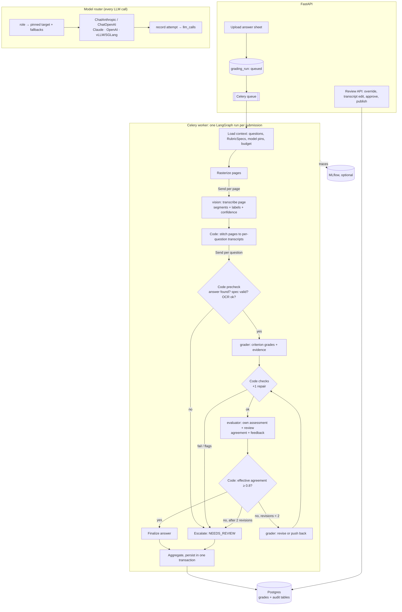
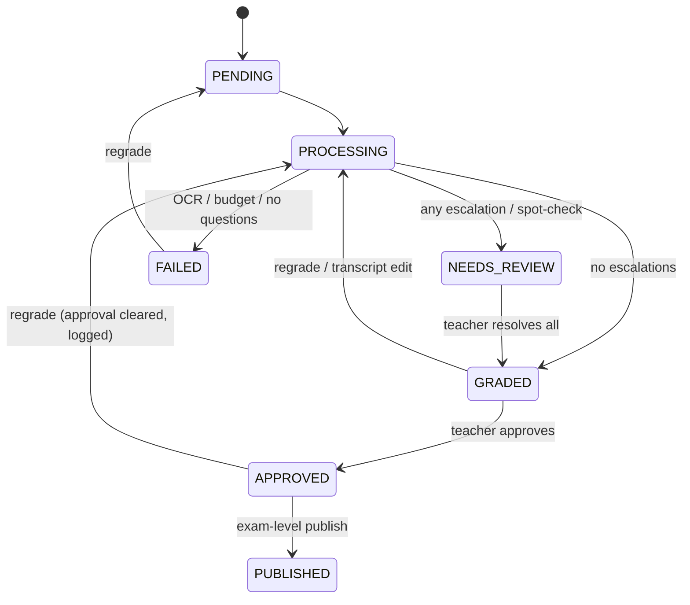

# Proposal 002: Grading v2 architecture (final)

| | |
|---|---|
| **Status** | **Accepted**, 2026-10-05 |
| **Supersedes** | [Proposal 001](001-production-grading-architecture.md) (draft), ADR-008, ADR-009 |
| **Tracking** | [Feature checklist](../grading-v2-checklist.md) · [v2 backlog](../v2-backlog.md) |
| **Base branch** | `v1-full`. One branch and PR per milestone; the owner merges each one. |

---

## 1. Summary

Gr8r grades handwritten exam answers. Version 2 makes grading **auditable**, **reviewable** and **model-agnostic**:

- **Pluggable models.** Every AI step (reading handwriting, parsing rubrics, grading, evaluating) can run on Claude (API key) or on a **self-hosted open-weight model** (vLLM / SGLang), with fallback in either direction.
- **Criterion-level grading.** A teacher's natural-language rubric is parsed once into a structured rubric. Every awarded mark points to a rubric criterion, a quote from the student's answer and a justification. Code adds up the marks.
- **Evaluator–optimizer loop.** A second model reviews each grade with fresh eyes. The grader can revise or push back, up to 2 rounds. Remaining disagreement goes to a teacher.
- **Complete audit trail.** Every AI call, every grading round and every teacher change is stored append-only in Postgres. Engineering traces and evaluations go to MLflow.
- **Teacher workflow.** A review queue, overrides with a reason, transcript corrections, approve, publish.

Guiding principle: **LLMs turn natural language into structured data; code enforces the rules.** Code does no regex parsing of natural language, and LLMs do no arithmetic that decides a grade.

---

## 2. Decisions

| # | Area | Decision |
|---|---|---|
| 1 | Orchestration | LangGraph, one graph run per submission inside a Celery task. Fan-out (`Send`) per page for OCR and per question for grading. No checkpointer. |
| 2 | Model layer | **Our router over LangChain chat models**, with two first-class backend families. **(a) Open-weight, self-hosted:** any model served by vLLM or SGLang through the OpenAI-compatible API (`ChatOpenAI(base_url=…)`), with structured output enforced by guided decoding. Ollama is supported for local development only. **(b) API models:** Claude through `ChatAnthropic`, using native structured outputs, effort, adaptive thinking and images; OpenAI through `ChatOpenAI`. Any role can use either family as primary or fallback. The router owns roles, fallback chains, budget, code checks, repair and audit recording. |
| 3 | Roles and defaults | Defaults need only an API key: `vision` = `claude-opus-5-5`, `rubric_parser` = `claude-opus-5-5`, `grader` = `claude-sonnet-5-5`, `evaluator` = `claude-opus-5-5`. Documented open-weight profiles need no code change: **hybrid** (grader on vLLM with Claude fallback) and **fully local** (every role on vLLM/SGLang, vision on a VLM such as Qwen3-VL). The eval harness decides which open model is good enough for each role. |
| 4 | LLM vs code | LLMs do every natural-language → structured extraction: OCR segmentation, rubric parsing, grading, evaluation. Code only checks, does arithmetic and routes. |
| 5 | Rubrics | `rubric_parser` produces a persisted, versioned **RubricSpec**: `kind` (`pass_fail` / `criteria`), `subject`, and criteria with points. Code validates it. A valid spec is used automatically; an invalid one blocks that question (its answers escalate) while other questions are still graded. An empty rubric produces a spec marked `derived`. |
| 6 | Grading | One grader call per answer, with few-shot examples per rubric kind. `pass_fail`: score ∈ {0, max} plus one evidence quote and a justification. `criteria`: score, evidence and justification per criterion; code sums. The grader can flag an answer (illegible, off-topic), which escalates it. |
| 7 | Evaluator loop | The evaluator is a different model. In each round it makes **one call**: first its own per-criterion assessment, then a review of the grader's evidence and justification, giving an agreement score (0–1) and feedback. Code takes `effective agreement = min(LLM agreement, score-gap agreement)`. Below **0.8**, the grader revises or pushes back. After **at most 2 revisions**, an answer still below threshold escalates to NEEDS_REVIEW with both positions stored. |
| 8 | Code checks | Schema; criterion ids match the spec; 0 ≤ score ≤ points; `pass_fail` ∈ {0, max}; total computed by code; evidence quote present in the transcript for every score > 0; non-empty justification; revisions consistent. A failure gets 1 repair retry, then escalates. |
| 9 | OCR | Rasterize pages, transcribe each page with a vision model (segments with question label, text, confidence), and stitch pages in code. Transcriptions are stored and versioned. A teacher edit regrades only that question. A question with **no answer found escalates**; it is never auto-zeroed. |
| 10 | Fallback and fairness | Per-role fallback chains, open-weight ⇄ API. Fallback is triggered by a transport error or timeout, a refusal, truncation after one retry, or invalid output after repair. A fallback grade is **accepted and recorded** with the model that answered. The grader's fallback never uses the evaluator's model. `ALLOW_EXTERNAL_FALLBACK=true` by default. Models, prompt versions and rubric spec versions are snapshotted per grading run. No Claude server-side refusal-fallback beta. |
| 11 | Audit and observability | Custom append-only Postgres tables are the system of record. MLflow 3.x is self-hosted and optional, for traces and evals. `mlflow_trace_id` is stored on each `llm_calls` row. |
| 12 | Migrations | Alembic replaces `create_all`. New status columns are VARCHAR. `NEEDS_REVIEW` is added to the existing Postgres enum; this is irreversible. |
| 13 | Workflow | `PENDING → PROCESSING → GRADED / NEEDS_REVIEW / FAILED → APPROVED → PUBLISHED`. Review queue, per-criterion override with a mandatory reason, transcript edit, approve, publish. The spot-check mechanism is built with a **default of 0%**. |
| 14 | Evals | Golden set of teacher-graded scripts plus public datasets for middle school, high school and college. Metrics go to MLflow. |
| 15 | Deferred | See [v2 backlog](../v2-backlog.md): stale grades after a rubric edit, spot-check rollout, refusal-fallback beta, per-org egress and budgets, bulk PDF splitting, and more. |

---

## 3. Architecture



---

## 4. Who does what: LLM vs code vs teacher

| Step | LLM (natural language → structure) | Code (rules) | Teacher (policy) |
|---|---|---|---|
| Rubric | Parse question + rubric text into a RubricSpec (kind, subject, criteria, points) | Validate: sum = max, unique ids, kind rules. Block if invalid. | Writes the rubric; can edit the parsed spec or re-parse |
| OCR | Transcribe each page into labelled segments with confidence | Stitch pages; flag low confidence or missing answers | Corrects transcripts |
| Grading | Per-criterion score, evidence quote, justification, flags | Schema, bounds, evidence-in-transcript, sum, repair or escalate | – |
| Evaluation | Own assessment, agreement, feedback | Effective agreement, loop control, escalation | – |
| Decision | – | Status transitions, totals, audit rows | Resolves escalations, overrides with a reason, approves, publishes |

---

## 5. Model layer

### 5.1 Roles and targets
- **Roles:** `vision`, `rubric_parser`, `grader`, `evaluator`.
- **What a role defines:** a **primary target** plus an ordered **fallback list**.
- **What a target specifies:**
  - `provider`: `anthropic` | `openai` | `openweight`
  - `model`, `base_url`, `effort`, `max_tokens`, `timeout`
  - capability flags: `supports_vision`, `supports_json_schema`, `external`
  - open-weight metadata: `model_revision`, `quantization`

Configuration uses nested environment variables, for example:

```env
# Shipped default: API only
LLM__GRADER__PROVIDER=anthropic
LLM__GRADER__MODEL=claude-sonnet-5-5

# Hybrid profile: self-hosted grader with Claude fallback
LLM__GRADER__PROVIDER=openweight
LLM__GRADER__BASE_URL=http://vllm:8000/v1
LLM__GRADER__MODEL=Qwen/Qwen3-32B
LLM__GRADER__FALLBACKS=[{"provider":"anthropic","model":"claude-sonnet-5-5"}]
```

### 5.2 Router behaviour
For every call the router does the following:
1. Builds the chain: the run's pinned primary plus fallbacks, minus excluded models (the grader never falls back to the evaluator's model), minus external targets if `ALLOW_EXTERNAL_FALLBACK=false`.
2. For each target:
   - checks the budget;
   - invokes it with a timeout;
   - inspects the stop reason.
3. **Refusal** → next target. **Truncation** → one retry with more tokens, then the next target. **Output fails validation** → one repair request (a fresh request containing the validation errors), then the next target. **Transport error or timeout** (after SDK retries) → next target.
4. Records every attempt (`AttemptRecord` → `llm_calls`), including failures, and the model that actually answered.
5. If every target fails, raises `LLMAllTargetsFailed`. The grading graph turns that into an escalation, or a FAILED run if the failure is in OCR.

Chat-model clients are created **per grading run**, because Celery runs each task in a fresh `asyncio` loop.

### 5.3 Structured output per backend

| Backend | Mechanism |
|---|---|
| Claude | `ChatAnthropic.with_structured_output(schema, method="json_schema", include_raw=True)`, which uses Claude's native structured outputs (`output_config.format`) |
| OpenAI | `ChatOpenAI` json_schema (strict) |
| vLLM / SGLang | `response_format` json_schema with server-side guided decoding (xgrammar) |
| Server without schema support | Schema in the prompt plus Pydantic validation; recorded as *degraded* |

Schemas omit numeric bounds (Claude's structured outputs don't support them); bounds are enforced by the code checks. Pydantic validation always runs.

**Claude constraints:**
- Never send `temperature`, `top_p` or `top_k` (Claude 4.7+ rejects them).
- Never force `tool_choice` or use an assistant prefill (Opus 5.5 and Sonnet 5.5 reject both).
- Set `effort` explicitly per role (Opus 5.5 defaults to `medium`).

### 5.4 Open-weight operations
- **Serving:** vLLM or SGLang in production.
- **Pinning:** pin the container image tag, the Hugging Face model revision and the quantization, and record all three per call.
- **Readiness:** use `/health` for readiness.
- **Ollama:** fine for laptops, not for concurrent production load.
- **Models:** vision roles need a vision-language model, such as the Qwen3-VL family. Recent benchmarks rank it best among open models for handwriting, but say handwriting OCR is "far from solved". Measure on our own data (M8/M9).
- **Deployment guide:** `docs/deploy/open-weight.md`, written in M2.

### 5.5 Why this shape (research summary)
- **What production LangGraph systems do.** Production LangGraph systems almost always use **LangChain chat models as the client**: all LangChain reference apps, the AWS and GCP references, and several companies. Large organisations add a gateway, and keep a native Claude path where Claude-specific features matter (GitLab subclasses `ChatAnthropic`). Fallback is custom code everywhere: built-in `with_fallbacks` only reacts to exceptions. We found no production codebase calling raw SDKs inside LangGraph nodes.
- **OpenHands:** rejected. It is a coding-agent platform where the LLM decides control flow. Its structured output is tool-based only, it goes through LiteLLM, and its dependencies are heavy and change fast.
- **LiteLLM:** rejected for the grade path. It had a confirmed PyPI supply-chain compromise (2026-03-24) and a critical proxy CVE (CVE-2026-42208), and Claude features are approximated in translation.
- **Pydantic AI:** a strong library, but its fallback and output modes overlap with our router. Not needed.
- **Accepted gaps of LangChain models:**
  - No Anthropic `request-id` header; we record the message id, model, stop reason and usage instead.
  - The exact HTTP bytes aren't captured; we record the rendered messages and invocation parameters.
  - If either becomes necessary, we subclass `ChatAnthropic`.

---

## 6. Rubrics

### 6.1 RubricSpec (v1)

```json
{
  "spec_schema_version": 1,
  "kind": "criteria",
  "subject": "science",
  "criteria_count": 3,
  "criteria": [
    {"id": "c1", "description": "Names light energy as the energy source", "points": 1, "expected_answer": null, "notes": null},
    {"id": "c2", "description": "Mentions chlorophyll / chloroplasts", "points": 1, "expected_answer": null, "notes": null},
    {"id": "c3", "description": "Gives reactants and products (CO2 + water → glucose + O2)", "points": 2, "expected_answer": "6CO2 + 6H2O → C6H12O6 + 6O2", "notes": "1 mark if only one side is correct"}
  ],
  "grading_notes": null,
  "parser_warnings": [],
  "derived": false
}
```

### 6.2 Validation (code)
- At least one criterion, and `criteria_count` equals the number of criteria.
- Ids are unique and non-empty, and descriptions are non-empty.
- Every `points` > 0, and the sum equals the question's `max_score`.
- `pass_fail` has exactly one criterion, worth `max_score`.
- `subject` is one of the allowed values.
- `derived` is true exactly when the rubric text is empty.

### 6.3 Lifecycle
1. **Parsing.** Specs are stored append-only in `rubric_specs`, with an `input_hash` of the question text, rubric text, max score and parser prompt version. When a question is created or edited, `parse_rubric_task` runs on a dedicated queue. Grading also parses lazily any spec that is missing or stale.
2. **Statuses:** `missing → pending → ready | invalid | error`.
3. **Teacher edits.** A teacher can edit the parsed spec (`source=teacher`) or trigger a re-parse.
4. **Grading.** Grading uses the current *ready* spec, and every grade records the spec version it used.

---

## 7. Grading and the evaluator–optimizer loop

### 7.1 Algorithm (per question)

```
precheck: no answer found | spec invalid | OCR confidence < threshold → escalate (reason)
g = grader(answer, spec, few-shots)              # one call, all criteria
g = checks(g) or repair once or escalate          # code
if g.flags: escalate(flags)
for round in 0..2:
    e = evaluator(answer, spec, g)               # own assessment first, then review
    eff = min(e.agreement, gap_agreement(e.own_assessment, g))   # code
    if any criterion gap > tolerance: eff = min(eff, threshold - ε)
    if eff ≥ 0.8: finalize(g); break
    if round == 2: escalate("evaluator disagreement", grader=g, evaluator=e); break
    g = grader.revise(answer, spec, g, e.feedback)   # accept/reject each point, with rationale
    g = checks(g) or repair once or escalate
```

`gap_agreement = 1 − |Σ grader − Σ evaluator| / max_score`. The per-criterion tolerance is 0 for `pass_fail` and configurable for `criteria`.

### 7.2 Prompt principles
- **Grader:** grade strictly against the rubric. Quote the student's exact words as evidence. Score 0 when there is no evidence. Few-shot examples per rubric kind show good evidence and justification.
- **Grader, revising:** "Reason independently. Do not change a score just to agree. Judge each feedback point on its merits; accept it if it is correct, otherwise push back with a specific rationale." Each feedback item must get an explicit accept or reject.
- **Evaluator:** "You are a fresh pair of eyes." It sees the answer and rubric first and writes its own per-criterion assessment *before* reviewing the grader's evidence and justification. It then gives an agreement score and specific feedback tied to criteria.
- **Subject personas:** reused from the current subject grader prompts (math, science, English, history, general). The subject comes from the RubricSpec, so no separate tagging call is needed.

### 7.3 Escalation reasons
`no_answer_found`, `rubric_invalid`, `low_ocr_confidence`, `grader_flag:<flag>`, `check_failed`, `evaluator_disagreement`, `all_models_failed`, `spot_check`.

### 7.4 Run-level failure policy
- **Per-question problems** escalate that answer only.
- **A whole submission is FAILED** only when:
  - OCR fails;
  - the budget is exhausted;
  - the exam has no questions.

---

## 8. Audit trail and observability

### 8.1 Tables (append-only; no soft delete)

| Table | Purpose and key columns |
|---|---|
| `grading_runs` | One per grading attempt. `submission_id`, `trigger` (upload, regrade, transcript_edit), `status`, `config_snapshot` (resolved targets and pins, prompt versions, thresholds, spec ids, git sha), `config_hash`, heartbeat and timestamps, call/token/cost totals, `error` |
| `llm_calls` | One per attempt. Run, role, purpose, question, round, attempt kind (initial, repair, truncation_retry, fallback). Model requested / model answered, provider, endpoint. The request (rendered messages and parameters; images by reference and sha256). Raw response, parsed output, stop reason, response id, request id when available. Tokens, cost, latency, fallback reason, error, schema hash, prompt version, `mlflow_trace_id` |
| `submission_pages` | Page images: storage key, sha256, size |
| `transcriptions` | Versioned per (submission, question). Source (ai, teacher), text, segments with page and confidence, flags, `is_current` |
| `answer_grades` | Versioned per (submission, question). Source (ai, teacher), spec and transcription ids, criteria results, total, every evaluator round (own assessment, agreement, effective agreement, feedback, accept/reject replies), flags, escalation reason, models used, fallback used, override reason, `is_current` |
| `grade_events` | Human and system actions: override, resolve, approve, unapprove, publish, transcript_edit, regrade_requested, escalated. Includes actor, before/after and reason |
| `rubric_specs` | Versioned parsed rubrics (§6) |

### 8.2 Integrity
- **Append-only enforcement:** Postgres triggers reject UPDATE and DELETE, except toggling `is_current`. An ORM guard does the same in SQLite tests.
- **Transaction boundaries:** `llm_calls` rows and run status are committed **as calls happen**, so a crashed run keeps its cost and debug record. Grade-bearing rows (transcriptions, answer_grades, projections, events, totals) are committed **together in one final transaction**.
- **Reconstructing a grade:** follow `answer_grades` → `rubric_specs` + `transcriptions` + `llm_calls` (by run and question) + `grade_events`.

### 8.3 MLflow
- **Deployment:** self-hosted MLflow 3.x, behind the compose profile `observability`. It is enabled only when `MLFLOW_TRACKING_URI` is set.
- **Tracing:** LangChain autolog in the worker, plus one root span per grading run. `mlflow_trace_id` is stored on `llm_calls`.
- **Safety:** tracing failures never fail a grading run.
- **Evals:** MLflow also stores the eval harness runs.
- **Why MLflow:**
  - It reuses our Postgres and object storage, so it is the lightest of the tools to run.
  - It has the most complete open-source eval tooling.
  - It is fully Apache-2.0.
  - It can redact data on the client.
- **What MLflow is not:** a system of record. Traces can be sampled, deleted or dropped under load.

---

## 9. Workflow



- **Review queue:** escalated answers first, then lowest effective agreement.
- **Review screen:** page image, editable transcript, criteria with highlighted evidence, grader and evaluator positions side by side, override with a mandatory reason, resolve, approve.
- **Students** see only `PUBLISHED` results.
- **Spot-checks:** a seeded random sample of confident answers goes to review. The rate is configurable per exam and **defaults to 0%**.

---

## 10. Evaluation

- **Golden set:** 5–10 teacher-graded scripts from the owner (M8), kept outside git.
- **Public suites (M9):** middle school, high school and college, built from licence-checked public Q/A datasets with human scores and rubrics or scoring guides.
- **Modes:** `full` (OCR + grading) and `grade_only` (from gold transcripts).
- **Model matrix:** Claude-only vs hybrid vs fully open-weight, per role. Also loop on/off, effort and threshold.
- **Metrics:**
  - agreement with teachers: MAE, QWK, exact and within-1 agreement;
  - escalation rate and revision flip rate;
  - evaluator drift from its own assessment (an anchoring measure);
  - OCR character error rate;
  - cost, latency, and bootstrap confidence intervals.
- **Gate:** every model, prompt or threshold change must be compared on the eval suites before rollout.

---

## 11. Operations

- **Idempotent tasks.** The API creates a queued `grading_run` and enqueues `grade_submission_task(run_id)`. The task takes an advisory lock and does nothing if the run is already finished. A run with a stale heartbeat is aborted and retried.
- **Celery settings.** `task_acks_late`, plus a Redis `visibility_timeout` longer than the task time limit, so a long grading run is never redelivered to a second worker while it is still running.
- **Budget.** A per-submission cap on calls, sized from pages × questions, and a cap in USD. Per-org monthly budgets come in the v2 backlog.
- **Privacy:**
  - Every external call and fallback is recorded.
  - `ALLOW_EXTERNAL_FALLBACK` controls whether a self-hosted primary may fall back to an external API.
  - Prompts carry question and answer text only, never student names.

---

## 12. Cost estimate

These are **estimates** for a 10-question, 4-page script with the default models. The eval harness will measure the real numbers.

| Item | Estimate |
|---|---|
| OCR (Opus 5.5, ~20k input tokens of images) | ≈ $0.14 |
| Grader (Sonnet 5.5), per answer per round | ≈ $0.02 |
| Evaluator (Opus 5.5), per answer per round | ≈ $0.044 |
| **Typical script** (about 20% of answers need one revision) | **≈ $0.90** |
| **Worst case** (every answer uses 2 revisions) | **≈ $2.00** |
| Rubric parsing | ≈ $0.03 per question, once per exam |

Cheaper options, each to be measured before adoption: open-weight grader (hybrid profile), Sonnet as evaluator, prompt caching of the shared exam context, and the Batch API for overnight bulk grading.

---

## 13. Risks and mitigations

| Risk | Mitigation |
|---|---|
| Evaluator anchors on the grader | Own assessment comes before the review in the same call; code compares score gaps; evals track evaluator drift |
| Grader caves to feedback (sycophancy), or the loop never converges | Revision prompt requires accept/reject with rationale; consistency checks; max 2 rounds, then escalate; evals track flip rate |
| LLM agreement scores are poorly calibrated | Effective agreement is capped by the actual score gap |
| Confidently wrong grades | Evidence must appear in the transcript; evaluator loop; spot-check mechanism (0% by default, can be enabled); eval-gated changes |
| Nondeterminism (no temperature on Claude 4.7+) | Pinned models per run; measure run-to-run variance in evals |
| Silently wrong rubric parses | "AI-parsed" and "derived" badges; teacher can edit or re-parse; spec version recorded on every grade |
| Celery redelivery causes double grading | Run-id idempotency, advisory lock, heartbeat, visibility timeout |
| Postgres enum changes | VARCHAR for new statuses; the single `NEEDS_REVIEW` enum addition runs in an autocommit block and is documented as irreversible |
| Fallback models score differently (fairness) | Answering model recorded on every grade; models calibrated in evals before they are allowed into a fallback list |
| Student data leaving our infrastructure | Egress setting, audit of every external call, no names in prompts |

---

## 14. Milestones

| M | Branch | Scope | Depends on |
|---|---|---|---|
| M0 | `docs/grading-v2-final` | This proposal, checklist, backlog, ADRs | – |
| M1 | `chore/ci-and-migrations` | CI, Alembic baseline, startup changes | – |
| M2 | `feat/llm-router` | Model router: roles, open-weight + API backends, fallback, structured output | M1 |
| M3 | `feat/audit-and-tracing` | Audit tables, recorders, idempotent runs, MLflow | M2 |
| M4 | `feat/rubric-parser` | RubricSpec, parsing, validation, API | M3 |
| M5 | `feat/grading-graph-v2` | New graph: OCR fan-out, grader/evaluator loop, escalation, persistence | M4 |
| M6 | `feat/review-workflow-api` | State machine, review/override/approve/publish API | M5 |
| M7 | `feat/review-ui` | Review UI (design skills: frontend-design, ui-ux-pro-max, design-system) | M6 |
| M8 | `feat/eval-harness` | Golden-set harness, metrics, MLflow | M5 |
| M9 | `feat/eval-datasets` | Public eval suites: middle school, high school, college | M8 |
| M10 | `chore/hardening` | Object storage, rate limits and circuit breaker, hash-locked dependencies, pre-commit | M3, M6 |

Details and acceptance criteria are in the [feature checklist](../grading-v2-checklist.md).

---

## 15. Sources (research, 2026-10)

- **Anthropic:**
  - [Building effective agents](https://www.anthropic.com/engineering/building-effective-agents)
  - [Demystifying evals for AI agents](https://www.anthropic.com/engineering/demystifying-evals-for-ai-agents)
  - [Structured outputs](https://platform.claude.com/docs/en/build-with-claude/structured-outputs)
  - [Model deprecations](https://platform.claude.com/docs/en/about-claude/model-deprecations)
- **LangChain / LangGraph:**
  - [LangGraph overview](https://docs.langchain.com/oss/python/langgraph/overview)
  - [Models](https://docs.langchain.com/oss/python/langchain/models)
  - [ChatAnthropic](https://docs.langchain.com/oss/python/integrations/chat/anthropic)
  - [Structured output](https://docs.langchain.com/oss/python/langchain/structured-output)
  - [Open SWE (model fallback reference)](https://github.com/langchain-ai/open-swe)
  - [Release policy](https://docs.langchain.com/oss/python/release-policy)
- **Production case studies:**
  - [LinkedIn GenAI stack](https://www.linkedin.com/blog/engineering/generative-ai/behind-the-platform-the-journey-to-create-the-linkedin-genai-application-tech-stack)
  - [Uber GenAI Gateway](https://www.uber.com/blog/genai-gateway/)
  - [GitLab AI gateway runbook](https://runbooks.gitlab.com/duo-workflow-svc/)
- **Alternatives considered:**
  - [OpenHands Software Agent SDK](https://arxiv.org/abs/2511.03690)
  - [Pydantic AI models](https://pydantic.dev/docs/ai/models/overview/)
  - [LiteLLM security update, March 2026](https://docs.litellm.ai/blog/security-update-march-2026)
  - [GHSA-r75f-5x8p-qvmc](https://github.com/advisories/GHSA-r75f-5x8p-qvmc)
- **Observability:**
  - [MLflow tracing](https://mlflow.org/docs/latest/genai/tracing/)
  - [MLflow self-hosting](https://mlflow.org/docs/latest/self-hosting/)
  - [Laminar](https://github.com/lmnr-ai/lmnr)
  - [OpenTelemetry GenAI conventions](https://github.com/open-telemetry/semantic-conventions-genai)
- **Grading research:**
  - [HealthBench (rubric criteria, per-criterion grading)](https://arxiv.org/pdf/2505.08775)
  - [Rubric-conditioned LLM grading](https://arxiv.org/abs/2601.08843)
  - [Autorubric](https://arxiv.org/abs/2603.00077)
  - [Prometheus](https://arxiv.org/pdf/2310.08491)
- **Open-weight serving:**
  - [vLLM structured outputs](https://github.com/vllm-project/vllm/blob/main/docs/features/structured_outputs.md)
  - [vLLM production stack](https://docs.vllm.ai/projects/production-stack/en/latest/)
  - [OmniHandwritingOCR](https://arxiv.org/pdf/2608.18586)
